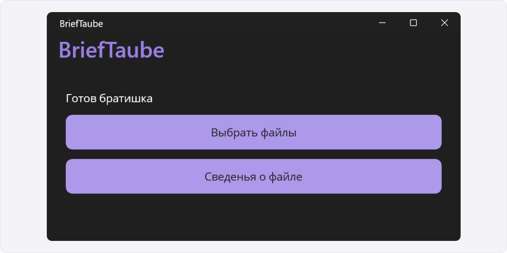

# BriefTaube
Учебный проект для обмена файлами и ссылками между Windows и Android.

---

*Главный экран BriefTaube в Windows.*

---

## Возможности прототипа
Можно выбрать файл через системное окно, посмотреть его размер и вычислить контрольную сумму SHA-256.

## План разработки(функционал)

- Передать один файл между Windows и Android по локальному IP через Wi-Fi или точку доступа телефона.
- Добавить автоматический поиск устройств в сети и подключение по QR-коду.
- Открывать гостевую передачу в браузере по одноразовому шестизначному коду.

Подробнее о проекте

*Brieftaube* по-немецки означает «почтовый голубь». Идея появилась в аудитории, когда одногруппнику понадобилось перекинуть отчет на пк и ему пришлось заходить в telegram.

Интерфейс написан на XAML с обработчиками событий на C# (Code-Behind). Для локального режима планируется обнаружение устройств по UDP и передача по TCP с проверкой SHA-256. Устройства смогут обмениваться данными через точку доступа даже без интернета.

В дальнейших планах — пакетная передача с отображением прогресса и скорости, отправка текста и ссылок в буфер обмена, подтверждение приёма, защита PIN-кодом и локальная история.

